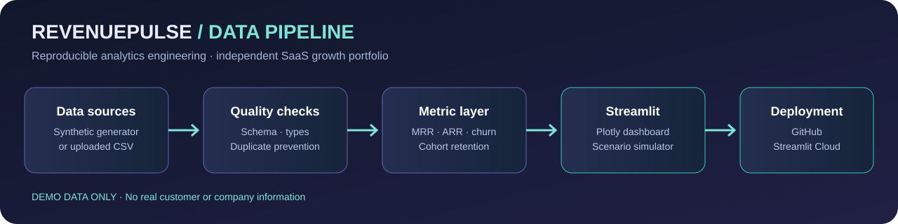

<div align="center">

# ◈ RevenuePulse
### SaaS Growth Intelligence Studio

**A modern, interactive analytics portfolio demonstrating recurring revenue analysis, customer retention, cohort intelligence, and growth scenario modelling.**



[](https://python.org) [](https://streamlit.io) [](https://plotly.com/python/) [](#data-ethics-and-limitations)

**[Live demo — add your Streamlit URL after deployment](https://share.streamlit.io/)** · **[GitHub profile](https://github.com/diegoallanalves)**

</div>

## The business question

A subscription business may be growing in total revenue while losing valuable customers. How can decision-makers distinguish **acquisition-driven growth** from **sustainable retention**, identify revenue concentration, and evaluate potential growth strategies?

RevenuePulse translates account-month data into accessible business metrics and interactive analyses. Unlike a housing market analysis, this project focuses on **SaaS commercial analytics and customer lifecycle performance**.

## Features

| Workspace | What it demonstrates |
|---|---|
| **Executive overview** | MRR, annualised run rate, active accounts, logo churn, revenue trends and plan mix |
| **Retention laboratory** | Signup-cohort retention heatmaps and acquisition-channel comparisons |
| **Revenue explorer** | Revenue segmentation by geography, product tier and acquisition source |
| **Scenario simulator** | Adjustable new revenue, expansion, churn and projection horizon |
| **Data quality & methodology** | Input schema validation, duplicate checks, missingness and metric definitions |

## Architecture


The current implementation uses a reproducible Python generator to create fictional account-month CSV data, or accepts a user-uploaded CSV with the same schema. The Streamlit app validates the input, computes metrics with Pandas and renders Plotly charts. GitHub and Streamlit Community Cloud are the intended publishing destinations, **not an automated CI/CD pipeline**.

## Quick start

```bash
git clone https://github.com/diegoallanalves/revenuepulse-growth-intelligence.git
cd revenuepulse-growth-intelligence
python -m venv .venv
# macOS / Linux
source .venv/bin/activate
# Windows PowerShell: .venv\Scripts\Activate.ps1
pip install -r requirements.txt
streamlit run app.py
```

If you have not created the repository yet, download this project, open its folder and run the final two commands locally instead of cloning.

The app opens at `http://localhost:8501`.

### Regenerate the demo data

```bash
python generate_data.py
```

A fixed random seed makes the generated example reproducible. It is designed for testing and presentation, not to reflect actual SaaS benchmarks.

## Data contract

`data/saas_accounts_demo.csv` uses these columns:

| Column | Meaning |
|---|---|
| `account_id` | Fictional account identifier |
| `month` | Calendar month in `YYYY-MM` format |
| `cohort_month` | First subscription month |
| `region` | Geographic market |
| `plan` | Subscription tier |
| `acquisition_channel` | Acquisition source |
| `mrr` | Monthly recurring revenue in illustrative GBP |
| `status` | `active` or `churned` |

One row represents an account in one month. The app rejects duplicate account-month combinations and invalid dates or negative revenue. To upload your own data, ensure it uses this schema and remove sensitive identifiers.

## Metric definitions

- **MRR:** Sum of active account recurring revenue for a month.
- **ARR run rate:** Current MRR × 12; **not** recognised annual revenue.
- **Logo churn:** Previous-month active accounts no longer active in the current month / previous-month active accounts.
- **Cohort retention:** Active accounts from a signup cohort at a given age / original cohort size.
- **Scenario ending MRR:** Repeated monthly application of expansion, revenue churn and new MRR assumptions.

These are deliberately transparent, educational definitions. For a production-grade financial model, reconcile cancellations, reactivations, billing cycles, currencies, upgrades, refunds and contract terms against a documented source of truth.

## Project structure

```text
revenuepulse-growth-intelligence/
├── app.py                       # Streamlit dashboard
├── generate_data.py             # Reproducible synthetic data generator
├── requirements.txt             # Python dependencies
├── README.md                    # Portfolio documentation
├── data/
│   └── saas_accounts_demo.csv   # Synthetic account-month records
├── assets/
│   └── pipeline.svg             # Editable architecture diagram
└── .streamlit/
    └── config.toml              # Dark theme
```

## Publish on GitHub and Streamlit

1. Create a **new public repository** named `revenuepulse-growth-intelligence` in your own GitHub account.
2. Upload the project files, including the hidden `.streamlit` folder. Do not upload `.venv`, secrets or private customer data.
3. Visit [Streamlit Community Cloud](https://share.streamlit.io/), select **Create app**, and connect your repository.
4. Select branch `main` and entry point `app.py`.
5. After successful deployment, replace the placeholder **Live demo** link above with your real app URL.
6. Add a real screenshot of the running dashboard to `assets/`, then embed it in this README.

## Data ethics and limitations

> **Important: all included customer, revenue, churn and geographic data is synthetic and fictional.** The app does not describe a real business or support factual claims about SaaS market performance. Never present synthetic outputs as genuine commercial findings.

The retention visual is descriptive, not a causal estimate. The scenario simulator is a deterministic what-if tool, **not a predictive forecast**. Its assumptions are intentionally simplified. Cohorts have unequal observation windows; comparing them requires care.

## Skills demonstrated

`Python` · `Pandas` · `NumPy` · `Data validation` · `KPI engineering` · `Cohort analysis` · `Customer retention` · `Revenue analytics` · `Plotly` · `Streamlit` · `Business storytelling` · `GitHub`

## Future roadmap

- [ ] Automated unit tests for metrics and input validation
- [ ] SQL/dbt transformation layer and documented metric models
- [ ] CI workflow for linting and tests
- [ ] Anonymised production data connectors (with permission)
- [ ] Revenue waterfall (new, expansion, contraction, churn)
- [ ] Model-based churn risk scoring with honest validation

---

**Created as an independent portfolio demonstration by Diego Alves.**  
[GitHub](https://github.com/diegoallanalves) · [LinkedIn](https://www.linkedin.com/in/diego-alves-data-specialist/)
